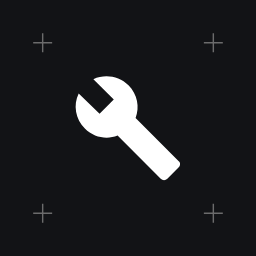

<p align="center">
  
</p>

<h1 align="center">Manutenção de Veículos</h1>

<p align="center">
  App Android gratuito e de código aberto para cuidar do <b>carro e da moto</b>:<br>
  alertas de troca por km e por tempo, lista de compras de peças, consumo, gastos com gráficos e relatório em PDF.
</p>

<p align="center">
  <a href="https://github.com/robertobegood-jpg/Manutencao-Veiculos-app-Android/releases/latest"><b>⬇️ Baixar o APK</b></a> ·
  <a href="#-cafezinho-para-o-dev"><b>☕ Apoiar o projeto</b></a> ·
  <a href="https://github.com/robertobegood-jpg/Manutencao-Veiculos-app-Android/issues"><b>💬 Sugestões e problemas</b></a>
</p>

---

## Funções

**Menu inferior:** Painel • Serviços • Compras • Posto • Mais

O seletor no topo troca o veículo, e todas as telas passam a mostrar os dados dele. Cadastre quantos carros e motos quiser.

### 📊 Painel
- Hodômetro com "Atualizar km" e o aviso de quando foi a última leitura.
- As próximas trocas, das mais urgentes para as menos.
- Gastos por período (mês, 6 meses, ano ou tudo): gasto total, **custo por km**, km rodados e consumo médio.
- Gráficos de gastos por mês, por categoria e de consumo por trecho.

### 🔧 Serviços
- Itens já cadastrados para **carro (14)** e **moto (11)**, como óleo, filtros, correia, kit relação e pneus, com intervalos que você ajusta.
- Cada item vence por **km**, por **meses** ou pelo que chegar primeiro, e guarda o **modelo** e a **referência** da peça.
- Situação de cada item: em dia, próximo, vencido, sem dados ou pausado.
- Registro de manutenção com data, km, itens trocados, oficina ou "feito por mim", peças, mão de obra e **fotos da nota fiscal**.

### 🔔 Alertas
- Verificação diária por volta das 9h, mesmo com o app fechado.
- Uma notificação por veículo com o que está vencido ou próximo, sem repetir todo dia.
- Lembrete para atualizar o km a cada 7, 15 ou 30 dias.

### 🛒 Compras
- Lista de peças por veículo, com modelo, referência, quantidade, preço, loja e total estimado.
- Um toque coloca na lista as trocas vencidas e próximas.
- Envio da lista em texto pelo **WhatsApp**, pronta para a loja ou o mecânico.
- As peças compradas viram um registro de manutenção já preenchido.

### ⛽ Posto
- Abastecimentos com litros, preço por litro e total. Basta preencher dois valores.
- **Consumo em km/l** pelo método do tanque cheio, por trecho e na média.
- Despesas avulsas: IPVA, licenciamento, seguro, multa, pedágio, estacionamento, lavagem e outras.

### ⚙️ Mais
- Relatório do veículo em **PDF**, útil na revisão e na hora de vender.
- Planilhas **CSV** para Excel e Google Planilhas.
- **Backup** completo em `.zip`, com fotos, e restauração em outro celular.
- Ajustes dos alertas e tema escuro, claro ou do sistema.

---

## Instalação

1. Baixe o arquivo `.apk` da [última versão](https://github.com/robertobegood-jpg/Manutencao-Veiculos-app-Android/releases/latest) pelo celular.
2. Abra o arquivo e permita **"instalar apps desconhecidos"** quando o Android pedir.
3. Ao abrir o app, permita as **notificações** para receber os alertas de troca.
4. **Atualizações:** baixe o APK da versão nova e instale por cima. Os dados continuam salvos.

> 💡 Quer ser avisado das versões novas? Use o [Obtainium](https://github.com/ImranR98/Obtainium) (gratuito e de código aberto): adicione o link deste repositório e ele avisa e instala as atualizações.

> Requer Android 8.0 ou superior.

### Primeiros passos
1. Cadastre o veículo com o km que aparece no painel.
2. Em **Serviços**, abra cada item importante e informe a última troca feita antes de usar o app. Sem isso, o app não sabe quando vence.
3. Ajuste os intervalos conforme o manual do seu veículo. Os de fábrica são só um ponto de partida.
4. Se os alertas não chegarem: *Configurações do Android › Apps › Manutenção › Bateria → Sem restrições*. Nos Xiaomi, ative também a *Inicialização automática*.

---

## Privacidade

- **Não há servidor, cadastro nem anúncios.** Veículos, registros, fotos e gastos ficam só no seu celular.
- O app **não tem permissão de internet**: nenhum dado sai do aparelho sem você mandar.
- Relatórios, planilhas, listas e backups só são enviados quando você escolhe para onde, pela janela de compartilhar do Android.
- As fotos da nota ficam numa pasta interna do app e entram no backup.

### Permissões
| Permissão | Para quê |
|---|---|
| Notificações | Avisar sobre trocas vencidas e próximas e lembrar de atualizar o km |
| Iniciar com o celular (automática) | Reagendar a verificação diária depois que o celular reinicia |

A câmera e a galeria são abertas só quando você toca em "Tirar foto" ou "Galeria", sem permissão permanente.

---

## ☕ Cafezinho para o Dev

O app é gratuito. Se ele ajuda você a cuidar do seu veículo, pode apoiar o desenvolvimento com um Pix de qualquer valor. Também dá para fazer isso direto no app, em **Mais › Pague um cafezinho**, com QR Code.

- **Chave Pix (e-mail):** `robertobegood+itau@gmail.com`
- **Nome:** Roberto Santos da Silva

**Pix copia e cola** (valor livre):
```
00020126630014br.gov.bcb.pix0128robertobegood+itau@gmail.com0209Cafezinho5204000053039865802BR5923Roberto Santos da Silva6009Sao Paulo62070503***63047463
```

Obrigado! 💛

---

## Para desenvolvedores

Kotlin + Jetpack Compose, com Room (banco local), WorkManager (alertas) e [ZXing](https://github.com/zxing/zxing) (QR Code). O visual segue o sistema de design **Oficina**: cantos retos, linhas finas e as fontes Archivo, Instrument Serif, Inter e Geist Mono.

```
app/src/main/java/com/roberto/manutencao/
  MainActivity.kt          tema e abertura pelas notificações
  data/                    banco (Room), cálculo de vencimentos, consumo, estatísticas e Pix
  alertas/                 verificação diária e notificações
  arquivos/                fotos, relatório PDF, planilhas CSV, backup e compartilhamento
  ui/                      telas, componentes, gráficos e tema Oficina
```

**Compilar:** abra a pasta no Android Studio e use *Build › Build APK(s)*, ou rode `./gradlew assembleDebug`. Sem a chave oficial, o APK sai assinado com a chave de debug padrão. Ele funciona normalmente, mas não atualiza por cima da versão oficial.

**Publicar uma versão** (mantenedor): suba `versionCode` e `versionName` em `app/build.gradle.kts`, escreva as notas em `notas/vX.Y.md`, faça o commit e crie uma tag `vX.Y`. O GitHub Actions compila, assina e publica a Release com o APK e as notas.

Sugestões e correções são bem-vindas por [issues](https://github.com/robertobegood-jpg/Manutencao-Veiculos-app-Android/issues) e pull requests.

## Licença

[GPL-3.0](LICENSE): você pode usar, estudar, modificar e redistribuir, desde que as versões derivadas também sejam abertas sob a mesma licença.

As fontes estão em `app/src/main/assets/fonts/`, sob a SIL Open Font License 1.1.

Desenvolvido por Roberto Santos da Silva.
